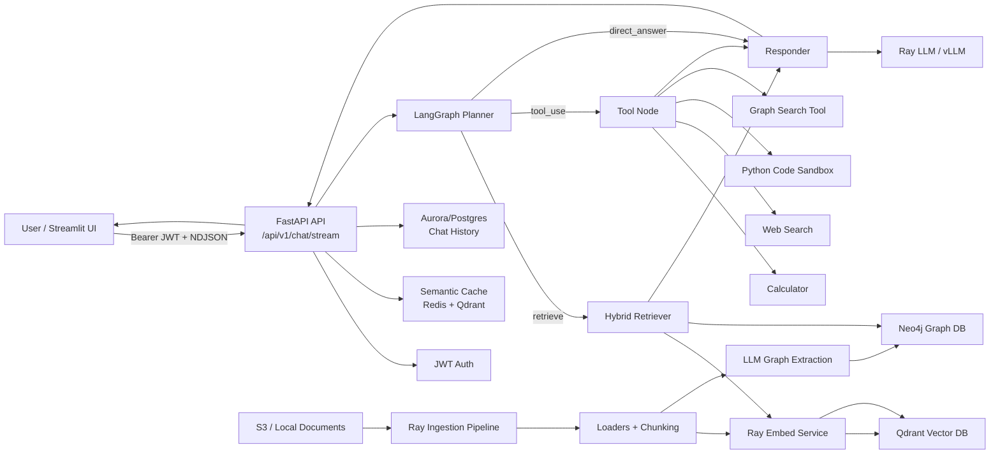
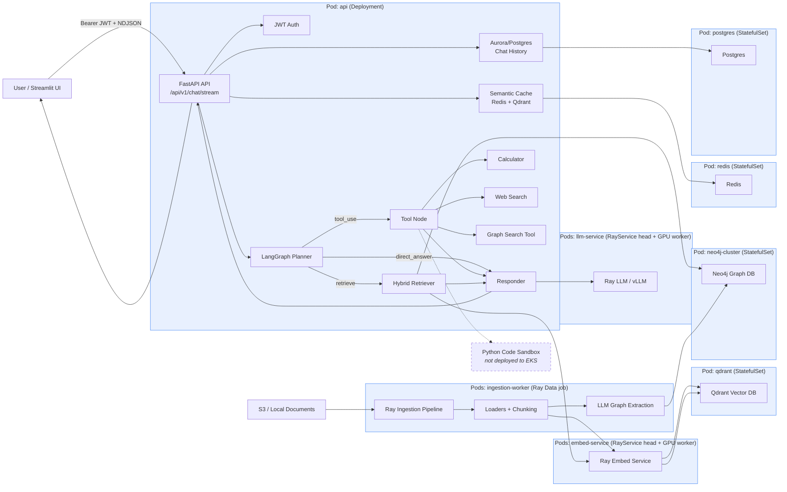
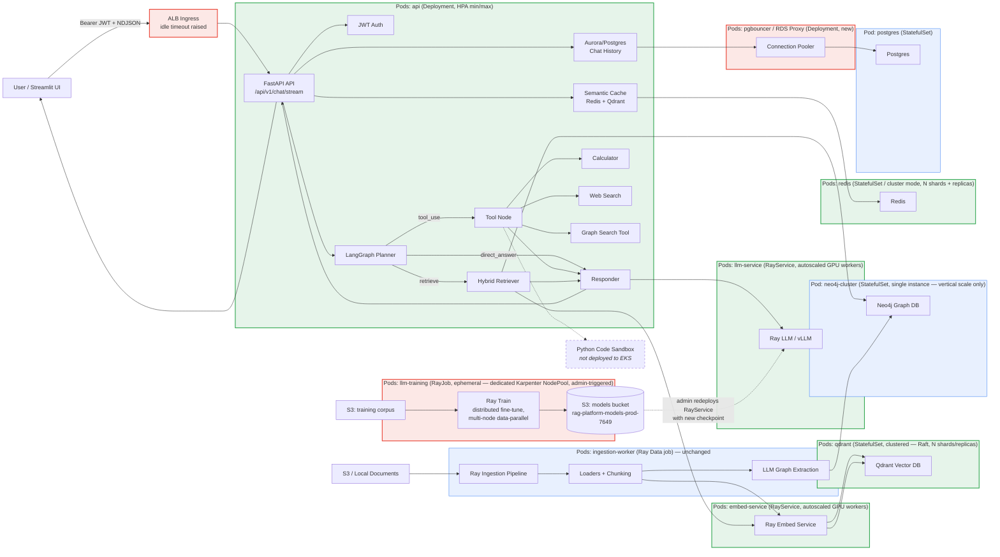
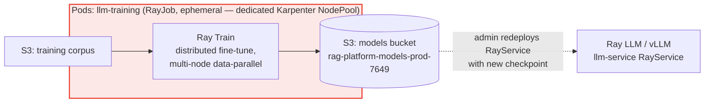
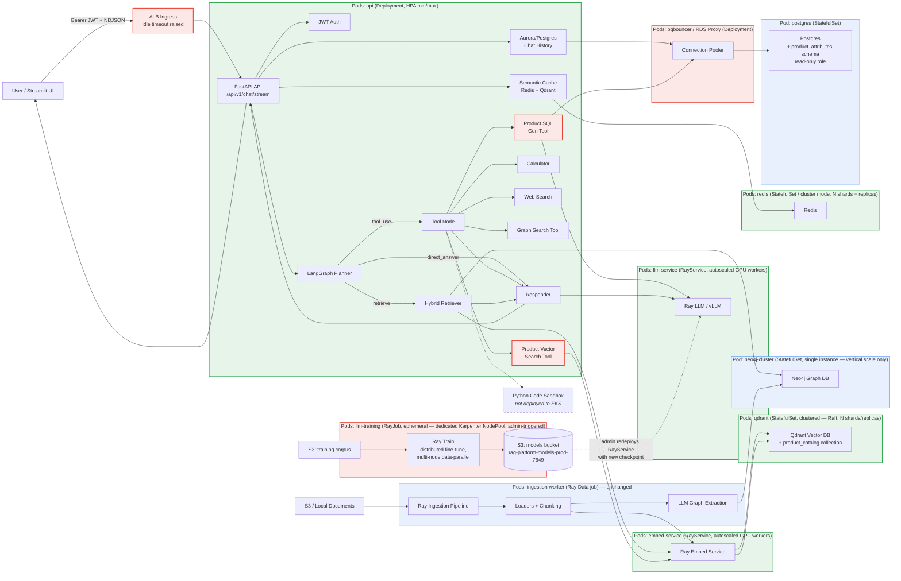
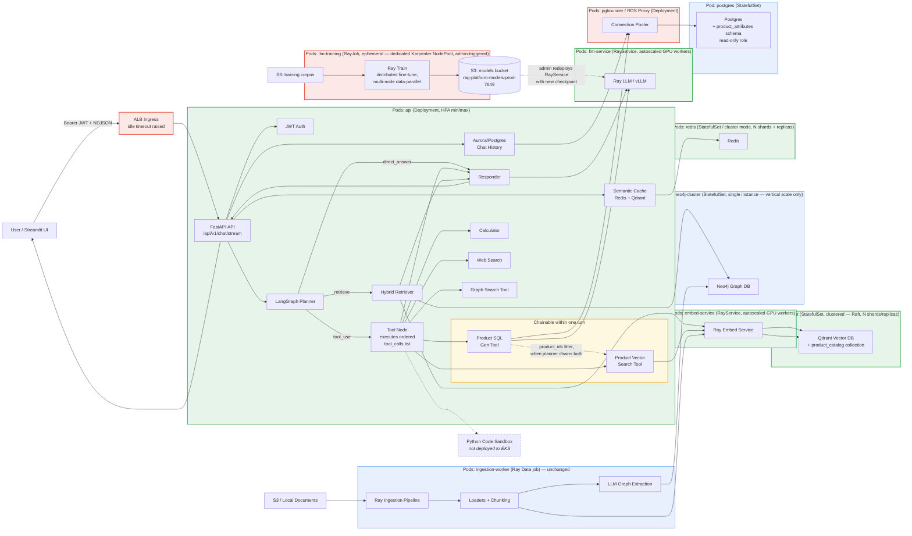

# Current Architecture Diagram

This Mermaid diagram reflects the implementation in this repository more
closely than the image. It includes the currently implemented tools and omits
components that are not present in code, such as a text-to-SQL generator.

## Summary

The deployed shape in the image is directionally right: this is an AWS/EKS RAG
platform with Terraform/Helm deployment, FastAPI ingress, JWT auth, semantic
cache, LangGraph planning, vector search with Qdrant, graph search with Neo4j,
Ray-hosted embedding and LLM services, ingestion from S3/documents, and
Prometheus/Grafana-style observability assets.

The main refinements from the code are:

- The user-facing API is specifically `POST /api/v1/chat/stream`, which streams
  newline-delimited JSON events.
- The planner routes to one of three paths: direct answer, retrieval, or tool
  use.
- Implemented tools are calculator, web search, sandboxed Python execution, and
  graph search.
- Hybrid retrieval embeds the query, then runs Qdrant vector search and Neo4j
  graph search concurrently before handing context to the responder.
- Chat memory is stored in Postgres/Aurora by `session_id`.
- A text-to-SQL generator is not currently implemented, and there is no code path
  that converts natural language to SQL against the RDBMS.

## Logic Flow

- **User / Streamlit UI** starts or continues a chat session. The UI sends the
  user's message, the current `session_id`, and a Bearer JWT to the streaming
  chat endpoint.
- **FastAPI API** receives `POST /api/v1/chat/stream`, validates the request,
  creates a session ID when needed, streams NDJSON events back to the client,
  and coordinates cache, memory, and LangGraph execution.
- **JWT Auth** validates the Bearer token and extracts the user context used by
  the chat route.
- **Semantic Cache** checks whether a semantically similar question has already
  been answered. It uses Redis/Qdrant-backed cache state; on a hit, the API can
  stream the cached answer without running the full agent graph.
- **Aurora/Postgres Chat History** stores user and assistant messages by
  `session_id`. Before agent execution, the API loads recent turns to provide
  conversation context.
- **LangGraph Planner** classifies the latest user query into one of three
  paths: `direct_answer`, `retrieve`, or `tool_use`. It calls the LLM for this
  routing decision.
- **Hybrid Retriever** runs when the planner selects `retrieve`. It embeds the
  refined query, searches Qdrant for semantically similar chunks, searches Neo4j
  for graph relationships, merges the results, and passes context to the
  responder.
- **Ray Embed Service** creates embeddings for online user queries and ingestion
  chunks. Query embeddings feed Qdrant search; document embeddings are indexed
  into Qdrant.
- **Qdrant Vector DB** stores document vectors and participates in semantic
  cache lookup. It is read during retrieval and written during ingestion.
- **Neo4j Graph DB** stores extracted entities and relationships. The retriever
  queries it directly during hybrid retrieval; the graph search tool can also
  query it when selected by the planner.
- **Tool Node** runs only when the planner selects `tool_use`. It dispatches the
  query to one specific registered tool, then passes the tool result to the
  responder.
- **Calculator, Web Search, Python Code Sandbox, Graph Search Tool** are the
  currently registered tools. The graph search tool is separate from normal
  retrieval: it uses the LLM to extract entities and then performs a safe,
  parameterized Neo4j neighborhood lookup.
- **Responder** synthesizes the final assistant answer. For retrieval, it uses
  retrieved context; for tool use, it uses tool output; for direct answers, it
  responds without retrieval. It calls the LLM for final generation.
- **Ray LLM / vLLM** is used by multiple blocks: planner routing, responder
  generation, graph-search-tool entity extraction, and ingestion-time graph
  extraction.
- **S3 / Local Documents** provide source files for ingestion.
- **Ray Ingestion Pipeline** loads documents asynchronously, chunks them,
  computes embeddings, extracts graph structures, and writes indexes to Qdrant
  and Neo4j. This is separate from the online chat request path.
- **LLM Graph Extraction** happens during ingestion, not during normal online
  retrieval. Its output becomes Neo4j graph data used later by retrieval and the
  graph search tool.

## EKS Pod Boundaries

Same blocks as above, with a box drawn around each group of blocks that runs
inside its own pod(s) on EKS. Blocks with no box are either AWS-managed
services (not a Kubernetes pod at all) or logic that executes in-process
inside another block's pod. The dashed node has no box because it isn't
deployed to EKS at all right now — see the mapping table below. Redis and
Postgres are boxed the same way as Qdrant and Neo4j, for simplicity; both
currently run as AWS-managed services (ElastiCache, Aurora/RDS) rather than
pods, but are shown here as if self-hosted on EKS. All four StatefulSet pods
(Qdrant, Neo4j, Redis, Postgres) are pinned to the same rightmost column via
invisible layout edges, so the diagram reads as: stateless/compute pods in
the middle, stateful pods on the far right.

## Block → Runtime Mapping

| Block(s) | Runs as | Notes |
|---|---|---|
| API, Auth, Planner, Retriever, Tool Node, Responder, Calculator, Web Search, Graph Search Tool | **Pod: `api` (Deployment)** | All in-process inside the same FastAPI pod — the LangGraph agent has no separate deployment per node |
| Qdrant Vector DB | **Pod: `qdrant` (StatefulSet)** | Same running instance backs both retrieval and the Qdrant half of the semantic cache |
| Neo4j Graph DB | **Pod: `neo4j-cluster` (StatefulSet)** | |
| Ray Embed Service | **Pods: `embed-service` (RayService head + GPU worker)** | |
| Ray LLM / vLLM | **Pods: `llm-service` (RayService head + GPU worker)** | |
| Ray Ingestion Pipeline, Loaders + Chunking, LLM Graph Extraction | **Pods: `ingestion-worker` (Ray Data job)** | Ephemeral job pods, not a long-running Deployment |
| Python Code Sandbox | *Not deployed* | Designed as an isolated `sandbox-service` pod (for code-execution isolation), but no Deployment/Service manifest exists in `deploy/` — the tool call has nowhere to reach |
| Semantic Cache (Redis half) | **Pod: `redis` (StatefulSet)** | Hypothetical — currently AWS-managed ElastiCache |
| Aurora/Postgres Chat History | **Pod: `postgres` (StatefulSet)** | Hypothetical — currently AWS-managed Aurora Serverless v2 or RDS |
| S3 / Local Documents | *Not a pod* | S3 (prod) or local filesystem (dev) |
| User / Streamlit UI | *Not a pod* | Client, outside the cluster |

## Scaling Path: 50K Users, 10K Concurrent

Where the load actually lands: 10K *concurrent* users means 10K long-lived
NDJSON streaming connections open at once, each blocked on a chain of calls
— cache check, retrieval (Qdrant + Neo4j), then LLM generation. The chain's
slowest, least parallel link is LLM generation (one 8B model forward pass
per token, GPU-bound); everything else in the chain is comparatively cheap
per request. That makes `llm-service` the primary scaling target, with
Qdrant, Redis, and Postgres connection/throughput limits as secondary
targets — not the request-routing logic itself.

Principle: every block below already has its own native scaling knob (K8s
HPA, Ray Serve autoscaling, or the data store's own clustering). Scaling to
this load means turning those knobs, not restructuring which block talks to
which — same boxes, same edges, no new services.

**Legend:** blue = unchanged from the base pod-boundaries diagram; green =
an existing pod whose replica count / autoscaling / clustering config
changes; red = a genuinely new component (ALB Ingress, connection pooler,
the `llm-training` RayJob). Everything else — node identities, edges, the
in-process grouping inside the `api` pod, the ingestion pipeline — is
identical to the base diagram above. The training pipeline is the one
exception to "capacity change, not a redesign": it's new capability, added
here rather than in its own diagram because it shares the same GPU-scaling
story as `llm-service` — see the discussion below.

| Block | Bottleneck at this scale | Minimal change | Why not bigger surgery |
|---|---|---|---|
| `api` pod | Holding 10K concurrent streaming connections; connection-handling capacity, not CPU — plus three code-level ceilings that cap a single pod regardless of replica count (see below) | Add an HPA on a concurrency metric (in-flight requests/connections per pod, **not** CPU — see caveat below), raise `replicas` min/max; put an ALB Ingress in front with the idle timeout raised above its ~60s default so long NDJSON streams aren't cut; **and** the four in-pod tuning changes listed below | Same FastAPI/LangGraph code, just more copies of the same pod — no split into microservices |
| `llm-service` (RayService) | GPU throughput per replica — a single 8B-model replica can't serve 10K concurrent generations | Raise Ray Serve autoscaling `min_replicas`/`max_replicas` and `target_num_ongoing_requests_per_replica`; raise the GPU Karpenter NodePool's node limit to match | vLLM + continuous batching stays as-is; Ray Serve replica scaling is the native mechanism, not a new serving stack |
| `embed-service` (RayService) | Cheaper per-call than LLM, but still linear in concurrent retrieval calls | Same lever: raise Ray Serve autoscaling min/max | |
| `qdrant` pod | Single-node read throughput, single point of failure | Turn on Qdrant's built-in clustering (Raft-based) and raise the StatefulSet replica count | Retriever's client calls don't change — Qdrant handles request distribution across its own shards/replicas internally |
| `neo4j-cluster` pod | **Real constraint**, not just a config change: Neo4j Community Edition has no read replicas — horizontal read scaling requires Enterprise (Causal Cluster) licensing | Interim minimal step: vertical scale (bigger instance, more page-cache RAM); graph search is already gated to the `retrieve`/`tool_use` paths, not every request | Flagging as a licensing decision to make explicitly, not something to code around |
| `redis` (semantic cache) | Cache lookup throughput, and hit-rate matters more as concurrency grows | Enable ElastiCache cluster mode / add read replicas | Highest-leverage change in this table — every cache hit skips LLM + Qdrant + Neo4j entirely; worth validating hit-rate assumptions against real query patterns before sizing, since highly personalized chat queries may cache worse than expected |
| `postgres` (chat history) | Connection count from many `api` pod replicas, not raw query throughput | Add RDS Proxy / PgBouncer in front of Aurora; keep Serverless v2 autoscaling as-is | Avoids re-architecting chat-history storage |
| `ingestion-worker` pods | Unaffected | No change — ingestion load is driven by document upload volume, not concurrent chat users | |
| `llm-training` (RayJob, new) | Not a request-path bottleneck at all — admin-triggered, ephemeral, runs once per fine-tune cycle, not per user request | New dedicated Karpenter NodePool, separate from `llm-service`'s `gpu-workers` group, so a training run's node claims can't compete with inference's autoscaling headroom during a rolling update | Reuses the same KubeRay/Karpenter substrate already running `llm-service`/`embed-service`/`ingestion-worker` — see the training pipeline section below for why a separate non-K8s island isn't warranted here |

### `api` pod: tuning that has to happen alongside replica count

Replicating the `api` pod is the right primary lever — everything inside it
(`services/api/app/clients/*`, `services/api/app/tools/*`) is genuinely
async (`httpx.AsyncClient`, `AsyncQdrantClient`, `AsyncGraphDatabase`), so
it's I/O-bound orchestration, not CPU-bound work, and scales fine via
horizontal replication.

**HPA metric choice matters here.** A default CPU-utilization-target HPA is
a poor fit for this pod precisely because it's I/O-bound: under heavy
concurrent load, coroutines sit waiting on the LLM/Qdrant/Neo4j/Redis/
Postgres calls rather than burning CPU, so CPU% can look comfortably low
while every pod is actually saturated with in-flight requests. A CPU-target
HPA would under-scale in exactly that situation. Use a concurrency-based
custom metric instead — in-flight requests per pod, or open streaming
connections per pod, exposed via a Prometheus adapter — so the HPA reacts to
actual load rather than an idle-looking CPU graph. (No HPA is defined for
this Deployment today — `deploy/helm/api/values.yaml` sets a static replica
count — so this is new work, not a config toggle.)

Checking the actual client code also turned up three ceilings that live
*inside* a single pod and don't move just because HPA adds more pods — plus
one inefficiency worth fixing regardless of scale:

1. **`ray_llm.py`'s connection pool caps at 50** —
   `httpx.Limits(max_keepalive_connections=20, max_connections=50)` bounds
   each pod to 50 concurrent in-flight LLM calls, independent of
   `llm-service`'s actual GPU capacity. 20 HPA replicas × 50 ≈ 1,000
   concurrent LLM calls fleet-wide — raise this limit in the same change as
   the HPA replica count, or the pool becomes the ceiling before GPU
   capacity ever is.
2. **`uvicorn.run(app, host="0.0.0.0", port=8000)` in `main.py:49` has no
   `workers=` argument** — one worker process per pod, i.e. one CPU core's
   event loop regardless of node size. Turning on multiple uvicorn workers
   per pod is a cheaper first lever than adding more pods, and should
   happen before or alongside HPA scale-out, not be skipped in favor of it.
3. **`ToolNode`'s outbound calls are unbounded** — `web_search_tool` and
   `run_python_code` both hit real external dependencies with unpredictable
   latency (bounded only by their 10s/6s `httpx` timeouts). Without a
   concurrency bound (e.g. a semaphore around tool dispatch), a burst of
   slow Tavily calls can occupy a disproportionate share of a pod's
   concurrent coroutines and degrade the `retrieve`/`direct_answer` path
   for other users sharing that replica — a tail-latency/blast-radius risk,
   not a throughput one. Same reasoning that already justifies keeping
   `Sandbox` out-of-process for security isolation, extended to
   `WebSearch`'s network dependency.
4. **`ray_embed.py`'s `embed_query` opens a fresh `httpx.AsyncClient()` on
   every call** instead of reusing a persistent client the way `ray_llm.py`
   does — a redundant TCP/TLS handshake on every single query embedding.
   Worth fixing independent of this scaling exercise; it compounds at 10K
   concurrent.

None of these four require splitting the pod into microservices — they're
config/tuning changes inside the same code, and are cheaper and more
directly load-bearing than a service split would be.

One existing gap becomes more consequential at this load: `responder.py`
has no retry/backoff around its LLM call (already in the backlog). Under
sustained GPU saturation, that means failures surface as generic `"An
internal error occurred"` errors instead of a graceful "server busy, retry"
— worth prioritizing alongside the `llm-service` autoscaling change rather
than after it.

Before committing to specific replica counts or instance sizes, run
`scripts/load_test.py` against a scaled-up `llm-service` to get real
throughput-per-GPU-replica numbers — the per-replica capacity depends on
model size, hardware, and prompt/output length, and shouldn't be assumed
from first principles.

## Training Pipeline: Fine-Tuning the Served LLM (Proposed)

Not implemented yet — no training code exists in this repo today (`ray.train`,
`fine-tune`, etc. don't appear anywhere under `pipelines/` or `services/`).
This section designs the shape a training pipeline should take, borrowing the
train → checkpoint → reload pattern from `agentic_search`'s
`docs/diagrams/current_architecture.md` (`ESCI dataset → scripts/train.py
(Ray Train) → checkpoint → export → Triton/FAISS`), adapted to what this
repo actually runs on — EKS + KubeRay + Karpenter — rather than
`agentic_search`'s raw EC2 ASGs. That substrate difference is exactly why the
adaptation isn't a straight copy; see the anti-pattern discussion below.

- **Trigger:** admin-only, out-of-band — a single operator applies an
  `llm-training` `RayJob` manifest when a fine-tune is warranted. Unlike
  ingestion (S3-event-driven, arbitrary volume) or chat (JWT-authenticated,
  thousands of concurrent users), this workflow has exactly one caller, so it
  doesn't need an API route, rate limiting, or multi-tenant isolation — the
  security boundary is "who has `kubectl`/CI access to this namespace," not a
  JWT scope.
- **Compute shape:** `RayJob`, not `RayService`. Training is a bounded,
  finite-duration run with no need for a long-lived head node serving
  traffic — the same ephemeral-job shape already used for `ingestion-worker`
  (`deploy/ray/ingestion-cluster.yaml`), not the always-on
  `enableInTreeAutoscaling` shape used for `llm-service`/`embed-service`
  (`deploy/ray/ray-serve-llm.yaml`).
- **Node isolation:** a separate Karpenter NodePool from the one backing
  `llm-service`'s `gpu-workers` group (which selects
  `karpenter.k8s.aws/instance-category: 'g'` today, 1 GPU/node, 0–20
  replicas). Training gets its own NodePool/taint so a training run's node
  claims can't compete with inference's autoscaling headroom.
- **Artifact handoff:** the checkpoint lands in the same `models` S3 bucket
  (`rag-platform-models-prod-7649`) already wired for KarpenterNodes' S3 read
  access and already used as the HF weight cache — no new bucket, no new IAM
  wiring. Promoting a checkpoint to serving is a separate, explicit step
  (rebuild the `services/ray-serve` image with the new weights baked in, or
  point `llm-service`'s RayService spec at the new S3 prefix), not an
  automatic reload — an admin should look at eval numbers before a fine-tuned
  checkpoint reaches production traffic.

### Is running training on EKS an anti-pattern?

No — but "run it on EKS" and "run it in the same scaling domain as
`llm-service`" are different claims, and only the second one is the actual
risk.

The case *for* EKS: this cluster already has the two hard parts of
distributed training solved. KubeRay already runs the `RayCluster`/`RayService`
CRDs backing `llm-service` and `embed-service`, and Ray Train's distributed
data-parallel training is the same primitive Ray Serve autoscaling already
depends on; Karpenter already provisions and tears down `g`-family GPU nodes
elastically. Standing up a parallel non-K8s island the way `agentic_search`
does — separate EC2 ASGs for `serve` and `train` — makes sense *there* only
because `agentic_search` has no Kubernetes at all: Docker Compose on raw EC2
is the only substrate, so per-workload ASGs are the only way to get elastic
isolation. Rebuilding that same raw-EC2 island here would mean
reimplementing scheduling, autoscaling, and node-lifecycle management this
cluster already provides — that's the actual anti-pattern to avoid, not
"EKS" itself.

The real risk isn't EKS, it's **quota and scheduling contention** if training
shares a scaling domain with inference:

- AWS's per-instance-family vCPU/GPU service quota is account-wide, not
  per-NodePool. A training run that claims several `g`-family GPU nodes at
  once can eat into the same quota ceiling `llm-service` needs to surge into
  during a rolling update — and this cluster is already flagged as running
  tight on GPU capacity (two-GPU headroom, no surge room during
  `llm-service` rollouts; see the K8s-upgrade notes). Adding a training
  workload without addressing that makes an existing constraint worse, not
  just additive.
- Mitigation is a NodePool-level split at minimum (so K8s-level scheduling
  can't starve inference), and a quota-level decision beyond that: either
  raise the account's GPU quota to cover peak(train) + peak(inference)
  concurrently, or accept that training only runs during known-low-traffic
  windows and treat that as an explicit operational constraint, not an
  assumption.
- Namespace/taint isolation also matters for blast radius independent of
  quota: a training job's OOM or a bad checkpoint write shouldn't be able to
  affect the `api` or `llm-service` pods' scheduling or node pressure.

**Bottom line:** keep training on EKS, using a `RayJob` plus a dedicated
NodePool — don't build a second EC2 island to mirror `agentic_search`'s
pattern. Do treat the GPU quota question as a real capacity-planning task
before the first real training run, not an afterthought.

## Scaling Path: Agentic E-Commerce Search (Proposed)

Not implemented yet. This is a copy of the "Scaling Path: 50K Users, 10K
Concurrent" diagram above, adapted so the Tool Node also supports agentic
e-commerce search: web search, calculator, graph search, and code sandbox
(all four already registered today) plus two new tools — vector search into
a product embeddings database and LLM-generated SQL against a product
attributes database. The model is `agentic_search`'s `product_search` +
`text_to_sql` tools (`docs/diagrams/current_architecture.md`), but the two
new tools here are built on this repo's existing Qdrant/Postgres substrate
rather than `agentic_search`'s FAISS index + SQLite file, for reasons below.

**Legend (delta from the base scaling diagram):** the two red tool nodes —
`Product Vector Search Tool` and `Product SQL Gen Tool` — are the only new
components. Everything downstream of them (`Embed`, `LLM`, `PgProxy`,
`Postgres`, `Qdrant`) is the *same* pod, reused, not a new deployment —
Qdrant gets a second collection, Postgres gets a second schema, and both
tools call the already-scaled `embed-service`/`llm-service` RayServices the
same way `Retriever` and `Responder` already do. This follows the base
diagram's own principle: same boxes, same edges where possible, capacity
change over redesign.

- **`Product Vector Search Tool`** (new file, e.g.
  `services/api/app/tools/product_search.py`, registered in
  `TOOL_REGISTRY`): embeds the query via the existing `embed_client`
  (`services/api/app/clients/ray_embed.py`) and searches a **second Qdrant
  collection** (`product_catalog`) on the same clustered `qdrant` StatefulSet
  that already backs `rag_collection` and the semantic cache — no new vector
  DB, no new pod. Note in passing: `services/api/app/tools/vector_search.py`
  already exists with a `search_vector_tool` function, but it's dead code —
  never registered in `registry.py`; `retriever.py` calls Qdrant directly
  inline instead. It targets the document collection anyway, so it isn't
  reusable as-is for products, but it's worth deleting or wiring up
  independent of this work — flagged in the backlog.
- **`Product SQL Gen Tool`** (new file, e.g.
  `services/api/app/tools/product_sql.py`): makes its own LLM call (through
  `llm_client`, same as `responder.py`) to translate the query into SQL,
  validated the way `agentic_search`'s `text_to_sql` validates it —
  structurally checked, read-only connection, `SELECT`-only, allowlisted
  schema, forced `LIMIT` — then executes against a **new `product_attributes`
  schema in the same Aurora/RDS cluster** that already hosts `chat_history`,
  through a distinct least-privilege read-only DB role, via the existing
  `pgbouncer`/RDS Proxy pooler. Deliberately *not* a second Aurora cluster:
  doubling RDS cost for schema-level isolation that a role + schema already
  gives you isn't justified here — flag this back if the product catalog's
  access pattern or compliance requirements turn out to need physical
  separation later.

**Open design gap, carried over from `agentic_search`'s own doc:** that
repo's Summary section already flags "SQL-first pre-filtering is half-built"
— `text_to_sql` runs but its `product_ids` never thread into `product_search`
as a filter. The same gap applies here, but it goes deeper than a missing
connector — see below.

### Root Cause: Why Single-Tool Dispatch Can't Express This

Not a classification-accuracy problem — a structural ceiling repeated at
four coupled layers of the stack, each independently encoding "one query →
at most one tool call":

1. **State schema** (`services/api/app/agents/state.py`): `AgentState` has
   scalar `tool_name: str` / `tool_input: str` fields, not a collection.
   There is no slot for "two tools."
2. **Planner's LLM output contract** (`nodes/planner.py`): one temperature-0
   LLM call, forced into `{"action", "tool_name", "reasoning",
   "refined_query"}` — `tool_name` is a single string by construction. The
   existing safeguard `if isinstance(tool_name, list): tool_name =
   tool_name[0] if tool_name else ""` is the tell: if the model ever emitted
   multi-tool intent, this line throws the second one away on purpose.
3. **Graph routing** (`agents/graph.py`): `route_after_planner` maps
   `action` to exactly one node, and `workflow.add_edge("tool",
   "responder")` is unconditional. The graph is a straight-line DAG —
   planner → {retriever | tool | responder} → responder → END — with no
   cycle back to the planner or to itself.
4. **Tool executor** (`nodes/tool.py`): `tool_node()` reads one
   `tool_name`/`tool_input` pair, calls one handler once, returns
   `documents: [result]`. No iteration construct exists in the function at
   all.

This was a coherent, deliberate tradeoff from when the tool set was
`calculator`/`web_search`/`sandbox`/`graph_search`: one LLM call for
planning is cheap, a straight-line DAG has no step budget to manage, and one
deterministic path per query keeps the semantic cache's per-tool
`cacheable` flag a clean per-turn property. It stayed invisible because none
of those four tools have a natural case where combining two beats picking
one. `product_sql` + `product_search` is the first case in this repo where
composability is load-bearing, not a nice-to-have: "waterproof jackets under
$50" needs both a structured filter and a semantic match, and no amount of
improvement to planner classification fixes that — the schema it must emit
into simply has no slot for "both."

Contrast with `agentic_search`'s own flagged gap: that retriever loop
already *can* call multiple tools per turn (a bounded ReAct loop,
`tool_budget.max_steps` capped at 8) — its gap is pure data plumbing (no
`filter_ids` parameter on the search tool). This repo's gap is one layer
earlier and wider: it can't call a second tool at all, regardless of
plumbing.

### How the Architecture Changes (Design Only — Not Implemented)

In causal order — fixing one layer without the others doesn't help:

- **State:** `tool_name`/`tool_input` → `tool_calls:
  List[{tool_name, tool_input}]`. Each entry needs its *own* tailored
  input — `product_sql` wants a constraint description ("price < 50,
  category=jackets"), `product_search` wants a semantic phrase
  ("waterproof") — not one shared `refined_query` reused across tools.
- **Planner contract:** the JSON schema asks for a short ordered list under
  `tool_use`; safeguards drop individual hallucinated entries rather than
  discarding the whole plan; a length cap (2–3) keeps this a short
  deterministic plan, not something open-ended.
- **Graph routing — the actual design fork:**
  - *Minimal fix (matches the stated need):* keep the graph shape as-is.
    `tool_use` still routes to one `tool` node; that node internally
    iterates the ordered `tool_calls` list, then still advances
    unconditionally to `responder`. No new edges, no cycle — "planner
    decides everything upfront" is preserved, just generalized from one
    tool to a short, upfront-decided sequence.
  - *Bigger fix (not needed here):* a conditional edge from `tool` back to
    itself or the planner, so the model reacts to intermediate results —
    effectively adopting `agentic_search`'s bounded ReAct loop. More LLM
    calls, a step budget to manage, more failure modes — and it solves
    reactive re-planning, which this need doesn't actually require, since
    the planner can decide upfront that both tools are needed without
    seeing intermediate output first.
- **Tool executor:** becomes a loop over `tool_calls`, accumulating into
  `documents` — nearly free, since `responder.py` already does
  `"\n\n".join(documents)`. The one genuinely new piece is a **narrow,
  hardcoded data dependency**: `product_sql`'s matched product IDs need to
  reach a following `product_search` call as a filter. Deliberately not a
  generic inter-tool plumbing mechanism (that would be over-engineering for
  one pairing) — a specific, named coupling that has to be visible in the
  executor, not implicit.
- **Second-order, not root cause but real:** `chat.py`'s cacheability check
  (currently one tool's `cacheable` flag) becomes "cacheable only if every
  tool in the turn is cacheable" — weakest link decides. Anything reading
  the singular `tool` field off the NDJSON routing event
  (`ui/streamlit_app.py`, `scripts/eval_pipeline.py`) moves to a list.
- **Untouched:** `retriever.py`'s hybrid-retrieval path, `direct_answer`
  routing, and the semantic cache's query-keying — none assume anything
  about tool count.

## Scaling Path: Compound Tool Calls for Agentic E-Commerce Search (Proposed)

Not implemented — this is a copy of the "Scaling Path: Agentic E-Commerce
Search" diagram above, modified to show what "How the Architecture Changes"
above looks like on the wire: the Tool Node now executes an ordered
`tool_calls` list within a single turn instead of one tool once, and
`Product SQL Gen Tool` can hand its matched product IDs to `Product Vector
Search Tool` as a filter when the planner chains both. Everything else —
every pod, every edge outside the Tool Node's internals — is identical to
the diagram above. This is deliberately *not* a scaling change: no new pods,
no new edges in the LangGraph itself (still `tool_use` → one `tool` node →
`responder`, per the "minimal fix" above) — the only thing that changed is
what happens inside that one node's execution.

**Legend (delta from the e-commerce diagram above):** the only new visual
element is the amber `Chainable within one turn` box grouping `Product SQL
Gen Tool` and `Product Vector Search Tool`, with the dotted arrow between
them showing the product-ID hand-off — everything else, including the
`Tool Node`'s single edge to `Responder`, is unchanged. That last point is
the one worth not missing: the fan-out from `ToolNode` to five tool nodes
still *looks* the same shape as before, and the graph-level edges genuinely
are the same — the difference is entirely inside what `tool_node()` does
once it's holding a list instead of one pair, plus the one hardcoded
`product_sql → product_search` coupling. A reader of the diagram alone,
without "How the Architecture Changes" above, could easily mistake this for
a bigger redesign than it is — it is not.
