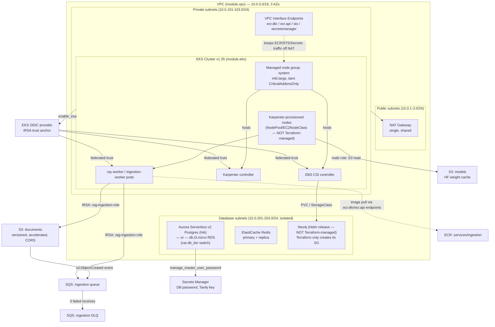

# Infrastructure Topology

This diagram reflects what `infra/terraform/*.tf` actually provisions — AWS
networking, EKS, data stores, storage/messaging, and IAM/OIDC wiring. It is
infra-focused, not request-flow-focused; for the application/agent
architecture, see [`current_architecture.md`](./current_architecture.md).

Scope note: Karpenter's `NodePool`/`EC2NodeClass` custom resources and the
Neo4j Helm release are applied via `kubectl`/Helm outside this Terraform root
— Terraform only provisions their IAM/networking prerequisites (Karpenter
controller/node IAM roles, the Neo4j security group). They are shown below
because they're part of the real topology, but are marked as not
Terraform-managed.

## What's provisioned vs. not

| Layer | Terraform-managed | Notes |
|---|---|---|
| VPC, subnets, NAT, endpoints | Yes | `vpc.tf` |
| EKS cluster + system node group | Yes | `eks.tf`, module `terraform-aws-modules/eks` ~>20.0 |
| Karpenter IAM (controller + node roles) | Yes | `karpenter.tf` |
| Karpenter NodePool / EC2NodeClass | **No** | Applied via `kubectl`/Helm outside this root |
| Aurora / RDS Postgres | Yes | `rds.tf`, tier switch on `var.db_tier` |
| ElastiCache Redis | Yes | `redis.tf` |
| Neo4j security group | Yes | `neo4j.tf` |
| Neo4j itself (StatefulSet, PVC) | **No** | Deployed as a Helm release; Terraform only preps the SG + EBS CSI addon |
| S3 (documents, models) | Yes | `s3.tf` |
| SQS ingestion queue + DLQ | Yes | `ingestion.tf` |
| ECR `services/ingestion` | Yes | `ingestion.tf`. `services/api` and `services/ray-serve` repos exist but are **not** Terraform-managed |
| Secrets Manager (DB password, Tavily key) | Yes | `rds.tf` (auto via `manage_master_user_password`), `secrets.tf` (conditional) |
| EBS CSI driver addon | Yes | `ebs-csi.tf` |

## Networking

Three subnet tiers across 3 AZs: **public** (NAT Gateway, future ALB/ingress —
tagged `kubernetes.io/role/elb`), **private** (EKS nodes, both the static
system node group and dynamically-provisioned Karpenter nodes — tagged
`kubernetes.io/role/internal-elb` and `karpenter.sh/discovery`), and
**database** (isolated tier for Aurora/RDS, Redis, and Neo4j's security
group). A single shared NAT Gateway serves all AZs' private subnets (not
per-AZ HA). An S3 Gateway endpoint keeps S3 traffic off the NAT entirely;
four interface endpoints (`ecr.dkr`, `ecr.api`, `sts`, `secretsmanager`) keep
image pulls, IRSA token exchange, and secret fetches off the NAT too.

## Compute

EKS v1.35 with IRSA/OIDC enabled. The only Terraform-managed node group is
`system` (m6i.large, 2–5 nodes, tainted `CriticalAddonsOnly`) — it exists
purely to host cluster-critical controllers (CoreDNS, the Karpenter
controller itself, an ingress controller, the EBS CSI controller) so they
never compete with, or get evicted alongside, workload nodes. All actual
workload capacity (GPU nodes for Ray Serve, CPU nodes for ingestion) comes
from Karpenter, whose NodePool/EC2NodeClass objects live outside this
Terraform root — Terraform only creates the IAM roles and EKS access entry
Karpenter needs to launch and register EC2 instances.

## Data stores

`var.db_tier` picks between Aurora Serverless v2 Postgres (2 instances, HA
failover, 2–64 ACU autoscaling) and a single `db.t3.micro` RDS instance —
both live in the database subnet tier and get their master password
auto-generated into Secrets Manager. Redis (ElastiCache, primary + replica,
encrypted at rest and in transit) backs the semantic cache. Neo4j has no
Terraform-managed compute — Terraform provisions only its security group
(Bolt 7687, HTTP 7474 from the VPC CIDR) and the EBS CSI addon its PVC
depends on; the database itself runs as a Helm release.

## Storage, messaging, and IAM/OIDC

The `documents` S3 bucket (versioned, Transfer Acceleration on, 30-day
lifecycle to Intelligent-Tiering) fires an S3 event notification into an SQS
queue on every upload; that queue has a DLQ after 3 failed receives, and is
consumed by `ray-worker`/`ingestion-worker` pods. The `models` S3 bucket
caches HuggingFace weights and is read directly by the Karpenter **node**
role (not per-pod IRSA) so GPU nodes can pull weights on cold start without
waiting on pod-level auth. The ingestion workers' own S3/SQS access comes
from a dedicated IRSA role (`rag-ingestion-role`) scoped to exactly two
service accounts. The EKS cluster's OIDC provider is the single trust anchor
behind every IRSA role in the stack (Karpenter controller, EBS CSI
controller, ingestion workers) — each federated trust is further restricted
to one specific `namespace:serviceaccount` via an STS condition, not just
the OIDC provider generally.
